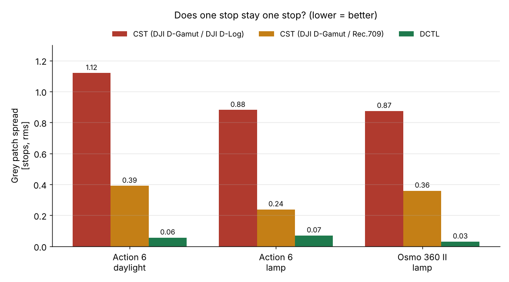
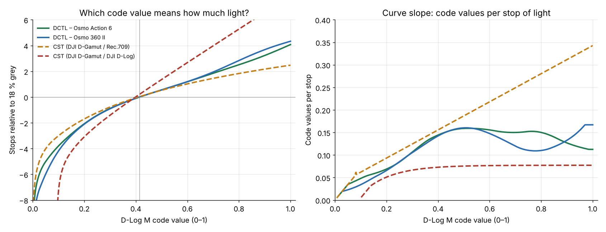
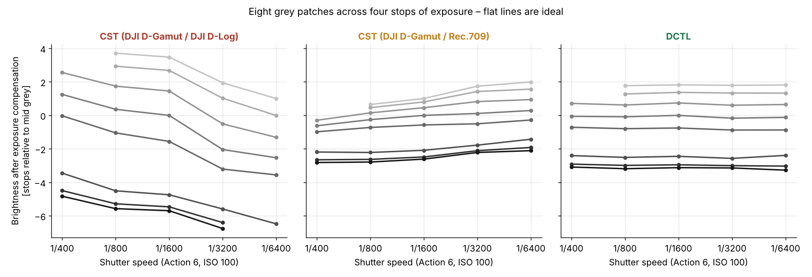
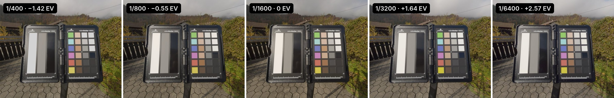
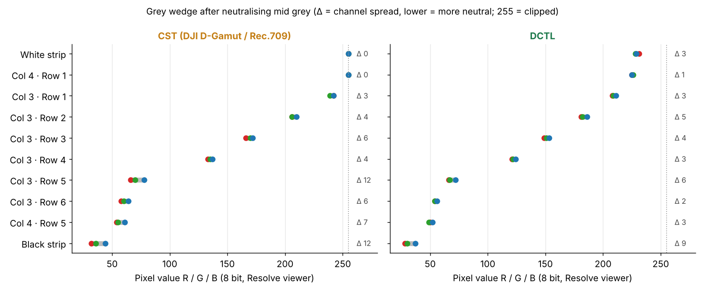
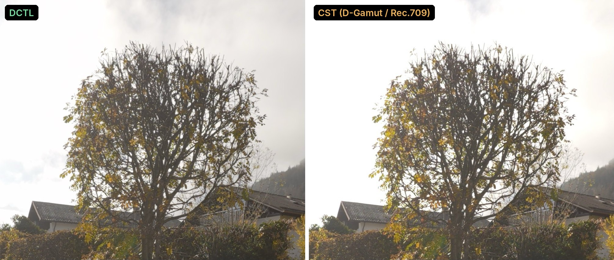
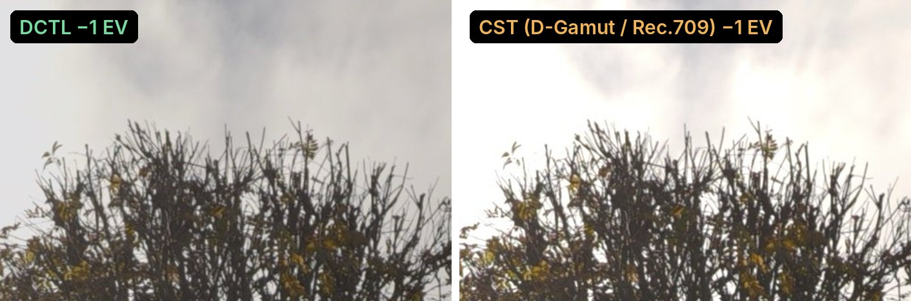
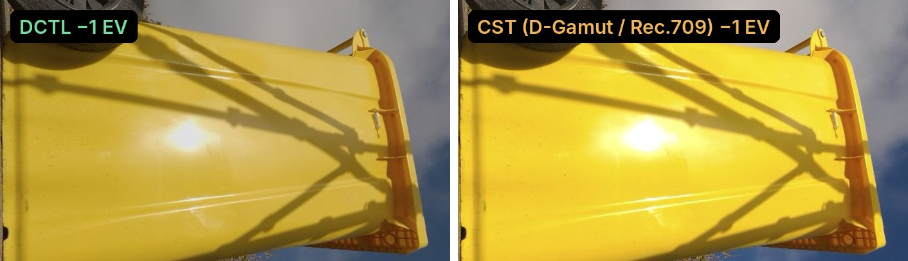
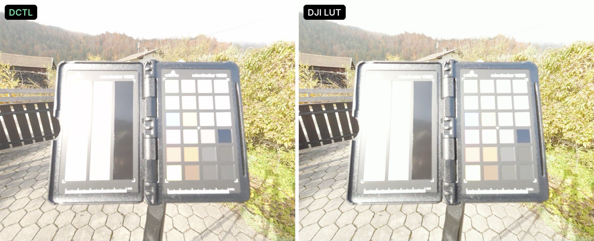

# DJI D-Log M → DaVinci Wide Gamut (DCTL)

A DCTL for DaVinci Resolve Studio that converts **DJI D-Log M** footage from the **Osmo Action 6** and **Osmo 360 II** into **DaVinci Wide Gamut / DaVinci Intermediate**. Both the curve and the colour matrix were measured with a colour chart, not guessed.

After this transform, one stop of exposure is one stop again, grey stays grey and highlights are no longer squashed. Grading the Osmo footage in DaVinci Wide Gamut then feels the same as grading footage from a cinema camera, for example Canon Log 2.

## Why this exists

DJI has not published a transfer curve or a gamut for D-Log M. The only official tool is a LUT to Rec.709 (`OA6 D-LogM to Rec.709 v11.17.cube`). If you want to grade in DaVinci Wide Gamut, you are stuck with a Color Space Transform that only approximates D-Log M:

| Workflow | What goes wrong |
|---|---|
| **CST (DJI D-Gamut / DJI D-Log)** | D-Log M is *not* the old D-Log. D-Log M stores about twice as much code per stop. Decoding it as D-Log roughly doubles the contrast in linear light, so the image looks harsh and oversaturated. |
| **CST (DJI D-Gamut / Rec.709)** | It looks close to the DJI LUT, but the highlights are compressed. At code 0.8, one real stop becomes about half a stop, and at code 0.9 about 0.4. Exposure changes in the grade behave unnaturally, and white clouds hit 100 % early. |
| HLG profile in camera | It bakes in an HDR look, which causes the bright halos around tree branches against the sky. |

## How the DCTL was made

All measurements use a Calibrite ColorChecker Video chart (grey strips, a grey wedge and colour patches), with ISO, white balance, sharpening (−2) and noise reduction (−2) fixed.

**1. Curve (code → scene-linear light), measured per camera**

- **Osmo Action 6, daylight:** shutter series from 1/25 to 1/6400 s at ISO 100. The light changed with the clouds. That variation was removed using the camera's own per-frame exposure meter, which DJI stores in the clip metadata. It agrees with the chart to ±0.05 stops.
- **Osmo Action 6, constant lamp:** 1/25 to 1/200 s, an independent check and extra data in the deep shadows.
- **Osmo 360 II, constant lamp:** 1/25 to 1/200 s at ISO 100, plus ISO 200, 400 and 800. ISO only acts as a gain in front of the curve, so the curve does not change.
- **Fitting:** each curve is a free spline fitted to all grey patches and all channels, with no assumed formula. The residual is about 0.005 code values (rms).
- **Black and white points:**
  - Black is code 0, confirmed with a capped-lens black frame.
  - Below code ≈0.03–0.05 the curve runs linearly through zero.
  - Above 1.0 it continues logarithmically.
- **Mid grey:** 18 % grey sits at D-Log M code **0.414**, the same placement the DJI LUT uses. In linear light that is 0.18.

| D-Log M code | Action 6, stops vs. 18 % grey | Osmo 360 II, stops vs. 18 % grey |
|---|---|---|
| 0.10 | −3.8 | −4.2 |
| 0.20 | −2.1 | −2.1 |
| 0.414 | 0 | 0 |
| 0.60 | +1.2 | +1.2 |
| 0.80 | +2.5 | +2.8 |
| 1.00 | +4.1 (≈ 300 nits) | +4.4 (≈ 360 nits) |

The left chart shows how much light each code value stands for. The right chart shows the slope of that curve: how many code values the camera spends on one stop of light. That is a property of the camera's encoding, not of the filmed scene, and it is exactly where the options differ. D-Log assumes only about half as many code values per stop as D-Log M, so every brightness change is stretched to about double. Rec.709 assumes too many code values per stop in the highlights, so it compresses them.

**2. Colour matrix**

- **Osmo Action 6:** derived from the official DJI LUT. Only LUT nodes that are neither clipped nor strongly saturated were used, where the LUT behaves exactly like a 3×3 matrix followed by one tone curve per channel. The residual is 0.004 code values over 344 nodes. The matrix is then converted to DaVinci Wide Gamut using Blackmagic's published primaries.
- **Osmo 360 II:** DJI provides no LUT for this camera. Both cameras filmed the same chart under the same lamp, and a 3×3 matrix aligns the 360 to the Action 6. Checked on daylight footage that was not used for the fit, it reduces the colour difference between the cameras from 0.34–0.40 to 0.19–0.30 stops per channel.

**3. DaVinci Intermediate** uses Blackmagic's published constants (DaVinci Resolve 17 Wide Gamut Intermediate).

## Tests

All tests were run in DaVinci Resolve Studio 21. Each one compares the DCTL with the CST (DJI D-Gamut / Rec.709), using the same output transform for both.

**Exposure series: does one stop stay one stop?**

Eight grey patches across four stops of shutter, after compensating for the exposure. The DCTL gives flat lines. The CST with Rec.709 drifts by about 0.4 stops, and the CST with DJI D-Log by more than 1 stop.

| | CST (D-Gamut / D-Log) | CST (D-Gamut / Rec.709) | **DCTL** |
|---|---|---|---|
| Action 6, daylight | 1.12 | 0.39 | **0.06** |
| Action 6, lamp | 0.88 | 0.24 | **0.07** |
| Osmo 360 II, lamp | 0.87 | 0.36 | **0.03** |

The table shows the rms spread in stops. A curve fitted only on the daylight data predicts the independent lamp series to 0.10 stops. The D-Log column is computed with the D-Log formula from DJI's white paper; it was not tested in Resolve.

**Grey wedge: neutral from white to black?**

Mid grey was neutralised with Offset, then R/G/B were read from the Resolve viewer.

- **DCTL:** the channels stay within 1 to 6 values over the whole wedge. The darkest strip is slightly bluer, which comes from sky reflections on the glossy black.
- **CST (D-Gamut / Rec.709):** the dark patches spread up to 12 values, and the two brightest patches clip at 255.

**Branches against a bright sky.** The DCTL keeps cloud detail. The CST with Rec.709 pushes the sky to flat white, and pulling exposure down by 1 stop does not recover it.

**Saturated yellow and specular highlight.** With the DCTL, the reflection on the bin keeps its gradation at −1 EV. With the CST (Rec.709), it stays burnt out.

**Look compared with the DJI LUT.** DCTL followed by an output CST with DaVinci tone mapping looks almost identical to the official DJI LUT. The difference is that you now grade in DaVinci Wide Gamut instead of on finished Rec.709 values. The clip is overexposed by about 3.5 stops, so many patches are clipped in camera.

## Usage

DCTLs require **DaVinci Resolve Studio**. The free version does not run them.

1. **Install:** in *Project Settings → Color Management → Lookup Tables*, click **Open LUT Folder**. Copy `DLogM_to_DWG.dctl` there, then click **Update Lists** or restart Resolve.
2. **Project settings:**
   - Color science: *DaVinci YRGB*.
   - Timeline color space: *DaVinci WG/Intermediate*.
   - If you use *DaVinci YRGB Color Managed* instead, set the input colour space of the D-Log M clips to *DaVinci WG/Intermediate*, so that Resolve does not convert them a second time.
3. **Node 1** of every Osmo clip: add the ResolveFX effect **DCTL** and select `DLogM_to_DWG`. Nothing may come before it. If you apply the DCTL through the node's LUT menu instead, it runs with the default settings and you get no controls.
4. **Set the controls.** The labels in the DCTL are in German:

   | Control | Options | Meaning |
   |---|---|---|
   | Kamera | Osmo Action 6 / Osmo 360 II | Camera |
   | Ausgabe | DaVinci Intermediate (default) / Linear | Output |
   | Farbraum | DaVinci Wide Gamut (default) / Rec709 linear Test | Colour space |
   | Belichtung EV | −6 … +6 | Exposure |

5. **Grade** in DaVinci Wide Gamut / Intermediate. For white balance and exposure, use **Offset**: in DaVinci Intermediate it acts as a true linear gain.
6. **Output transform** at timeline level: CST from DaVinci Wide Gamut / DaVinci Intermediate to Rec.709 / Gamma 2.4, with Tone Mapping *DaVinci*, *Use Custom Max. Input* and Gamut Mapping *Saturation Compression*.
   - Max. Input ≈ **300 nits** for Action 6 projects, ≈ **360 nits** for 360 projects.
   - If you mix in another camera, for example Canon Log 2, use the value that suits that camera. The D-Log M highlights then sit a little lower, which is physically correct, and you lift them in the grade.

Shoot with fixed ISO and white balance where possible. The measurements were made with Sharpness −2 and Noise Reduction −2 set in camera, so use the same settings.

## Limits

- **Cameras:** only the Osmo Action 6 and Osmo 360 II were measured. Other D-Log M cameras (Pocket 3, Mini/Air/Mavic drones, Action 4/5) may use a different curve. Do not assume it fits them.
- **Matrices:** the Action 6 matrix is what DJI's LUT implies, so any saturation choice DJI built into the matrix part of the LUT is carried over. The chart has no published reference values, so absolute colour accuracy (ΔE) was not measured.
- **Osmo 360 II colours:** after alignment, very saturated greens and reds stay slightly stronger than on the Action 6.
- **Clipping:** above about 4.1 (Action 6) or 4.4 (360) stops over mid grey, D-Log M is clipped in camera. No transform can recover that.
- **Mid grey:** the 0.414 placement follows the DJI LUT convention. If your exposures land elsewhere, use *Belichtung EV*.

## Files

- `DLogM_to_DWG.dctl` – the transform: two 513-point curves, two matrices and the DaVinci Intermediate encoding.
- `docs/` – charts and comparison images used above.

The DJI LUT is not included. Download it from DJI if you want to compare.

Measurement, analysis and DCTL were developed with the help of Claude (Anthropic).
